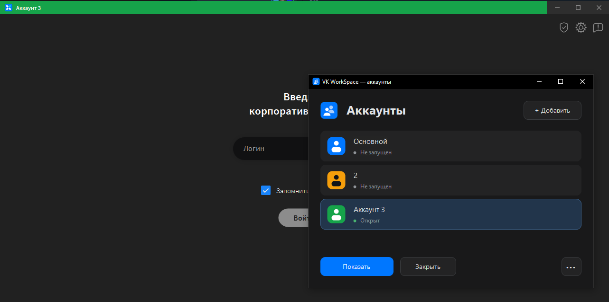

# VK WorkSpace Switcher

Лаунчер для одновременной работы с несколькими аккаунтами  VK WorkSpace.

## Использование

Запустите **`bin\VKWorkspaceSwitcher.exe`**. Для работы достаточно этого файла и установленного VK WorkSpace.

- **Основной** — существующий профиль приложения.
- **Добавить** — создать профиль и войти в нужный аккаунт.
- **Открыть / Показать** — запустить профиль или переключиться на его окно.
- **Закрыть** — штатно завершить выбранный экземпляр; кнопка видна только у работающего профиля.
- **«⋯» / правая кнопка мыши** — переименовать профиль, выбрать цвет шапки, открыть папку данных или указать путь к приложению.





## Сборка

Требуются Windows x64, .NET Framework с `csc.exe` и Visual Studio / Build Tools с компонентом **Desktop development with C++** (MSVC x64 и Windows SDK).

```powershell
powershell.exe -NoProfile -ExecutionPolicy Bypass -File .\build.ps1
```

Результат — `bin\VKWorkspaceSwitcher.exe`. Иконка и native-модуль шапки встроены в EXE. Промежуточные файлы удаляются автоматически.

<details>
  <summary>Spoiler warning</summary>
P.S спасибо codex. Навайбкодено astra6 --- https://t.me/waisbStuff
</details>
